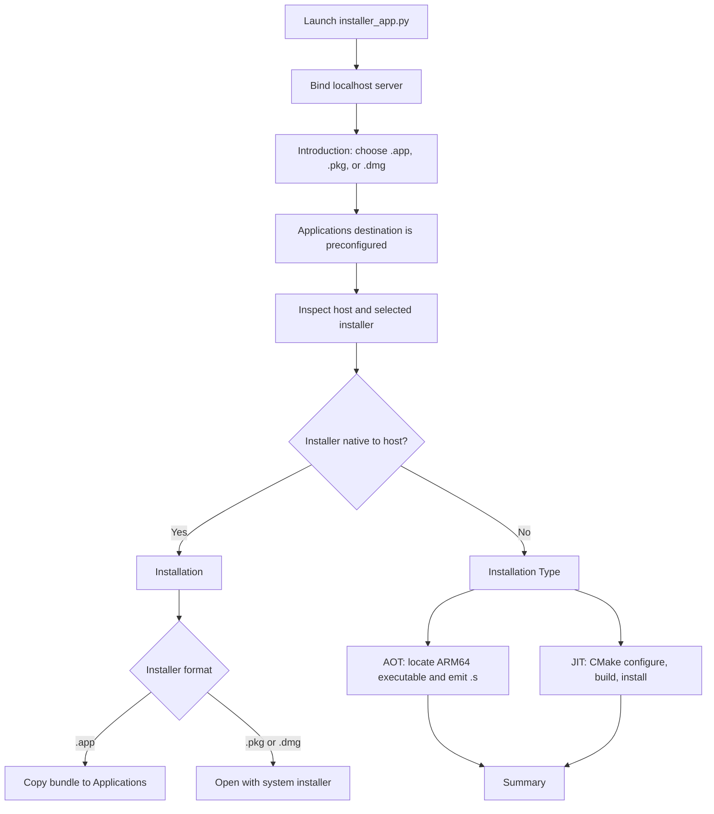
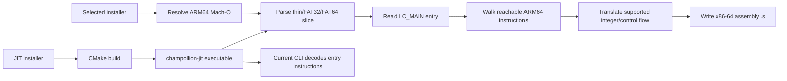

# macOS Monterey Handoff

Status: audited on Windows 11 with CMake 4.4.4, Zig 0.16.0, and Ninja. The C++ targets build and the JIT installer pipeline installs the command-line executable on Windows. The installer and Mach-O flows pass synthetic tests. This is a development handoff, not a claim that full ARM64 application translation is ready.

## Project Map

```text
installer_app.py
  Local HTTP server bound to 127.0.0.1 on an ephemeral port
  /                 serves installer_ui.html
  /api/status       reports host and available build tools
  /api/select-installer opens the OS file chooser for .app/.pkg/.dmg
  /api/detect       inspects installer architecture
  /api/install      queues native install, AOT translation, or JIT build
  /api/tasks/<id>   returns task state and build/translation output

installer_ui.html
  Introduction -> Computer Type -> Installation Type (non-native only)
  -> Installation -> Summary

proto/macho.py + proto/arm64_decode.py
  Portable Python Mach-O parser and ARM64 decoder reference

proto/aot_translator.py
  Walks reachable code at LC_MAIN and emits limited x86-64 assembly

src/ + include/champollion/
  C++ Mach-O loader, ARM64 decoder, IR skeleton, and x64 backend
```

## Installer Flow



The current native `.pkg`/`.dmg` path opens the original installer; it does not silently install package contents. On macOS, Computer Type uses `pkgutil`/`hdiutil` to inspect package contents. AOT also extracts or mounts supported containers temporarily and attempts to locate an ARM64 app executable. Temporary DMG mounts are detached after inspection.

## Translation Data Flow



## UI Specification

- Window frame: classic package-installer layout with title bar, vertical step rail, white bordered work area, and bottom navigation.
- Introduction: concise installer copy, installer picker, and fixed `~/Applications/Champollion` destination. The user does not type a destination.
- Computer Type: reports host architecture and installer architectures.
- Native selection: skips Installation Type and proceeds to Installation.
- Non-native selection: opens Installation Type with AOT preselected and JIT available when CMake plus a C++ compiler are detected.
- Installation: displays progress, command output, or actionable failure details.
- Summary: shows the copied application, generated assembly path, or JIT executable path.
- Responsive layout: desktop sidebar becomes a swipeable step rail on narrow screens.

## Monterey Setup

On the Intel macOS Monterey target, install Xcode Command Line Tools first:

```sh
xcode-select --install
```

Use Python 3.10 or newer (3.11/3.12 recommended) with Tk support for the native file chooser. Install CMake 3.21+; Ninja is optional when using the Xcode/Make generator. AppleClang supplies the C++20 compiler. Do not copy the Windows Zig executable or Windows build output to the Mac.

From `champollion-jit/`:

```sh
python3 run_tests.py
cmake -S . -B build -DCMAKE_BUILD_TYPE=Debug
cmake --build build --parallel
./build/bin/champollion-jit /path/to/arm64-mach-o
python3 installer_app.py
```

The browser installer binds only to `127.0.0.1`. The first run should use a copied test app, not an installed production app. Inspect DMGs read-only and detach them after testing.

## Current Verified State

| Area | Verified behavior | Not verified or incomplete |
|---|---|---|
| Python tests | Import, decoder, synthetic Mach-O, AOT, and installer API suites pass on Windows | macOS Monterey run remains outstanding |
| Python Mach-O loader | Thin ARM64 and ARM64 slices in FAT32/FAT64; LC_MAIN; bounds checks | Unusual chained-fixup, encrypted, and malformed real-world binaries need corpus tests |
| C++ Mach-O loader | CMake build succeeds; executable loads synthetic thin, FAT32, and FAT64 files and decodes `MOVZ`/`RET` | Full package corpus and Monterey AppleClang build not yet run |
| AOT | Supported integer operations/local branches emit x86-64 `.s` | Not a complete function set, object, executable, or replacement `.app`; calls, memory, SIMD, relocations, dyld and frameworks are missing |
| JIT | CMake builds/installs `champollion-jit`; CLI loads Mach-O and decodes entry | `X64Backend::compile` emits only `ret`; no translated code executes |
| Native installer | `.app` copies to Applications; native `.pkg`/`.dmg` open through the OS | Real test DMGs have not been opened on macOS |
| OS downgrader | Source exists at `proto/downgrader.py` | Broken/incomplete; do not use. It edits binaries and invalidates signatures |

The provided test installers are `Raycast_2.8.2.0_d6aec411b0_arm64.dmg` and `VSCode-darwin-arm64.dmg` under `C:\Users\Jacob\Intel Champolion\TEST INSTALLERS`. On this Windows machine only their DMG format and filenames were confirmed. Their contents and architectures must be inspected on Monterey.

## Priority TODO

### P0: Monterey transfer gate

- Run `python3 run_tests.py` on Monterey and save the complete output.
- Configure and build with AppleClang on the intended Intel/x86_64 Monterey Mac.
- Run the built CLI on both supplied DMGs after read-only mounting; record bundle executable names, Mach-O architectures, `LC_MAIN`, and unsupported instructions.
- Test the native `.app`, `.pkg`, and `.dmg` UI paths manually, including cancellation, duplicate app install, missing CMake, and cleanup of mounted volumes.
- Confirm whether the target is specifically Intel Monterey. Apple Silicon Monterey is a different host target and cannot be treated as x86_64 simply because the input app is ARM64.

### P1: Mach-O and decoder correctness

- Add C++ unit tests matching the Python fixtures for thin, FAT32, FAT64, endianness, section offsets, `LC_MAIN`, dylibs, symbols, and malformed command bounds.
- Add C++ decoder tests for every supported opcode and compare outputs with LLVM/`otool` on Monterey.
- Correct and test register 31 semantics (SP versus XZR/WZR), 32-bit writes, flags, and conditional branches.
- Parse `LC_BUILD_VERSION`, `LC_VERSION_MIN_MACOSX`, code-signing metadata, chained fixups, and actual entry points for relevant file types.
- Reject unsupported file types/slices with errors rather than falling back to the first executable segment without warning.

### P2: Make AOT produce a real binary

- Replace assembly-text output as the final artifact with a tested x86_64 Mach-O object/executable pipeline.
- Implement full instruction decoding/lowering for the app corpus: load/store, address generation, calls/returns, indirect branches, flags, FP/SIMD, atomics, and exception/system instructions as required.
- Build a CFG across function boundaries, handle relocations and symbols, and define an explicit ABI for the guest-register context.
- Add guest-memory mapping, dyld rebases/binds, chained fixups, imported symbols, system frameworks, and Objective-C/Swift runtime support.
- Preserve or intentionally recreate code signing; never claim editing a minimum OS load command makes an incompatible app compatible.
- Differential-test generated code against ARM64 execution for each supported instruction and run whole apps on an Intel Monterey machine.

### P3: Make JIT actually execute

- Replace the `ret` stub with IR lowering, register allocation, branch linking, and complete block-cache behavior.
- Use macOS `MAP_JIT`/`pthread_jit_write_protect_np` with correct hardened-runtime entitlements and W^X handling.
- Integrate decoded instructions into IR and call the backend from the CLI; currently `main.cpp` only loads/decodes and initializes the backend.
- Add macOS execution tests and verify translated results against native ARM64 runs.

### P4: Installer and release readiness

- Make the JIT option describe and launch a usable translated runtime only after P3 is complete.
- Add cancellable build/translation tasks, clear recovery paths, and installer logs that do not imply successful app translation when only assembly was emitted.
- Decide whether the deliverable is a signed `.app`, `.pkg`, or developer tool; build/sign/notarize it on macOS.
- Remove or rewrite `proto/downgrader.py`; it currently has invalid Mach-O header assumptions and destructive signature-invalidating behavior.
- Add a real C++ `tests/` target before enabling CMake `BUILD_TESTS`; that directory does not currently exist.
- Keep `run_tests.py` as the cross-platform test entry point and verify that generated files stay ignored.